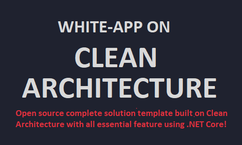

# Complete solution for Clean architecture using .NET Core

<br />
<p align="center">
  <a href="#">
    
  </a>

  <h3 align="center">Clean Architecture</h3>

  <p align="center">
    Complete solution template which is built on Clean Architecture with all essential feature using .NET Core!
    <br />
    <a href="https://amitpnk.github.io/Clean-Architecture-ASP.NET-Core"><strong>Explore the docs »</strong></a>
    <br />
    <br />
    <a href="https://marketplace.visualstudio.com/items?itemName=AmitNaik.CleanArchitecture">Download from Marketplace</a>
    ·
    <a href="https://github.com/Amitpnk/Clean-architecture-ASP.NET-Core/issues">Report Bug</a>
    ·
    <a href="https://github.com/Amitpnk/Clean-architecture-ASP.NET-Core/issues/new">Request Feature</a>
  </p>
</p>

## Give a Star! :star:
If you like or are using this project to learn or start your solution, please give it a star. Thanks!

## Support This Project

If you have found this project helpful, either as a library that you use or as a learning tool, please consider buying me a coffee:

<a href="https://www.buymeacoffee.com/codewithamit" target="_blank"></a>

## Clean Architecture

Clean Architecture was introduced by by Robert C. Martin (Uncle Bob) to provide a better way to build applications in perspective of better testability, maintainability, and dependability on the infrastructures like databases and services

Domain in center and building layer top of it. You can call it as Domain-centric Architecture too.

Though layer architectures like onion, Hexagonal all vary somewhat in their details, they are very similar. All DDD approach have the same objective, which is the separation of concerns. 

### Reference

* [Clean Architecture by Robert C. Martin (Uncle Bob)](https://blog.cleancoder.com/uncle-bob/2012/08/13/the-clean-architecture.html)

## About The Project

This project provides complete solution which is built on Clean Architecture with all essentia,  feature CI/CD, best practice, testing Strategy using .NET 10.



## Technology stack

Architecture Pattern

- [x] Clean architecture
- [x] (Includes)
    - [x] Screaming architecture-[Functional organisation design](http://blog.cleancoder.com/uncle-bob/2011/09/30/Screaming-Architecture.html)
    - [x] Onion archhitecture

Design Pattern
- [x] CQRS design pattern
- [ ] Decorator design pattern
- [x] Mediator design pattern (lightweight custom CQRS dispatcher - no MediatR dependency)
- [x] Repository design pattern
- [x] Unit of work 
- [x] Factory design pattern
 
Backend
- [x] Language: C#
- [x] Framework: .NET 10 (LTS), ASP.NET Core 10

UI
- [ ] Blazor

Database
- [x] MS SQL and Inmemory DB
- [x] DB Connectivity : Entity Framework Core 10 - Code First (migrations included)

Cloud server
- [x] Azure (deployment script)

Service
- [x] Web API (Restful service)
- [ ] gRPC
- [ ] Graphql

Feature
- [x] Dataseeding
- [x] Custom Exceptionn Handler
- [x] Mapster (object mapping)
- [x] Fluent validation
- [x] Serilog (console + rolling file)
- [x] Swagger UI (Swashbuckle, OpenAPI 3)
- [x] Advanced Pagination
- [x] API Versioning (Asp.Versioning)
- [x] User Auditing (audit columns + AuditTrails table)
- [x] Mailkit (Mail service)
- [ ] Hangfire
- [x] Enabling CORS with CustomPolicy
- [ ] BenchmarkDotNet

Authentication
- [x] JWT Authentication with ASP.NET Core Identity

Monitoring tool
- [x] Health check UI
- [ ] Kibana dashboard  

Testing
- [x] Unit testing for every layer (NUnit 4, Moq, EF Core InMemory)
- [x] Integration testing (xUnit v3 + Testcontainers: real SQL Server in Docker; `WebApplicationFactory` for the API)

Caching
- [ ] Inmemory Caching
- [ ] Distributed Redis Caching

CI/CD
- [x] Task runner: GitHub Actions and CircleCI
- [ ] Coverage report: Sonarcloud.io
- [ ] Quality report: Codacy
- [x] Docker image (multi-stage Dockerfile) and docker-compose (API + SQL Server)
- [ ] Kubernetes
- [ ] Cloud server: Azure for cloud

Documentation
- [x] Conventional commit - commit and commit message    
- [x] Docsify

Tooling
- [x] Central package management (Directory.Packages.props) with NuGet vulnerability audit
- [x] SDK pinned via global.json; dotnet-ef as a local tool (dotnet-tools.json)

## Running with Docker

```bash
docker compose up --build
```

This starts SQL Server 2022 and the API; migrations and seed data are applied on startup.
Swagger is at http://localhost:8080/swagger and the health check UI at http://localhost:8080/healthcheck-ui.
Sign in with `superadmin@gmail.com` / `Password@123`. Override the SQL `sa` password with the `SA_PASSWORD` environment variable.

## Tests

| Project | Framework | Covers |
| --- | --- | --- |
| `CleanArch.Domain.UnitTests` | NUnit | `BaseResponse`, `ValueObject`, entities, request validation attributes |
| `CleanArch.Application.UnitTests` | NUnit | Every command/query handler and validator, CQRS dispatcher, mappings, exceptions, exception middleware |
| `CleanArch.Infrastructure.UnitTests` | NUnit | CSV export, logged-in user, clock, service registration |
| `CleanArch.Persistence.UnitTests` | NUnit | Repositories, audit trail, seed data, `AuthenticationService` (real Identity over EF InMemory) |
| `CleanArch.Api.UnitTests` | NUnit | Controllers (mocked dispatcher), Swagger file-result filter |
| `CleanArch.Persistence.IntegrationTests` | xUnit v3 | Migrations and repositories against real SQL Server |
| `CleanArch.Api.IntegrationTests` | xUnit v3 | HTTP endpoints and JWT auth against real SQL Server |

The integration tests use [Testcontainers](https://dotnet.testcontainers.org/) to start a throwaway SQL Server
container per test assembly, so Docker must be running. To run only the unit tests:

```bash
dotnet test CleanArch.sln --filter "FullyQualifiedName!~IntegrationTests"
```

## Licence Used

[](https://github.com/Amitpnk/Clean-architecture-ASP.NET-Core/blob/develop/LICENSE)

See the contents of the LICENSE file for details

## Contact

Having any issues or troubles getting started? Drop a mail to amit.naik8103@gmail.com or [Raise a Bug or Feature Request](https://github.com/Amitpnk/Clean-architecture-ASP.NET-Core/issues/new). Always happy to help.
